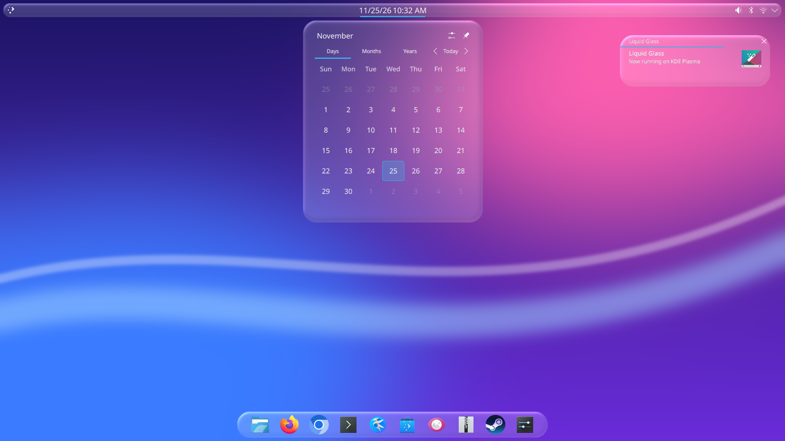
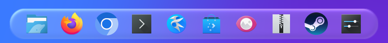
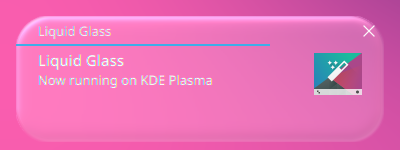
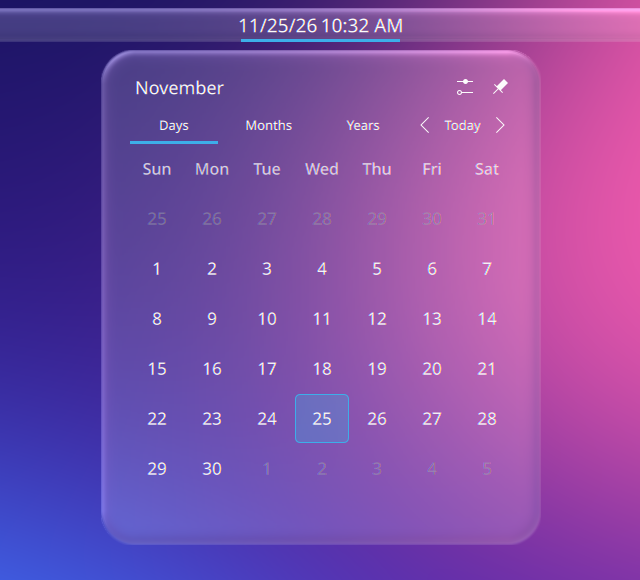
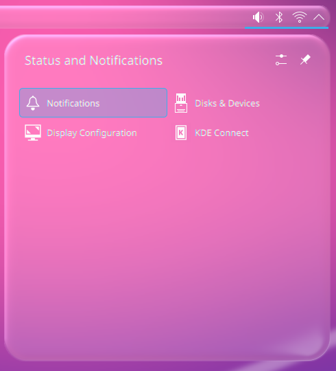
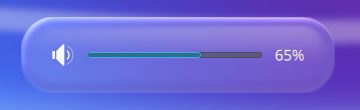

# Liquid Glass for KDE Plasma 6

A KWin effect that brings the liquid glass shader from the GNOME extension to Plasma,
plus a frameless Plasma Style, so the glass itself is the shape: pill-shaped panels and docks,
and popups with 34px rounded corners.

### Demo

Overview:



Dock (floating panel with Icons-only Task Manager):



Notifications:



Panel popups (Digital Clock):



System Tray (the Plasma counterpart of Quick Settings):



OSD:



All six are real screenshots: Plasma 6.8.3 with the Breeze Dark colours, a smooth
gradient wallpaper (like the GNOME screenshots use), and this effect and Plasma Style at
their default settings.

## How it works

It is a fork of KWin's built-in **Blur** effect. Every surface that asks KWin for blur
already gets the glass, with no per-app setup: panels, popups, notifications, OSDs,
KRunner, and translucent apps and decorations. KWin's background capture and dual-Kawase
blur are kept as they are. The final composite pass (`src/shaders/glass.frag`) is the
Three.js prototype's shader, ported to KWin: a superellipse bezel that bends the
background near the edges, Snell refraction, chromatic aberration, and additive rim,
specular and sheen lighting. The bezel samples the unblurred background, so it acts as a
crisp lens around the frosted middle, and is shaded by its own curvature: lighter on the
side facing the light, slightly darker on the side away from it. The highlight sits on the edge facing the light, with a faint
one opposite, instead of an outline all the way round. The defaults give a frosted body
with a clearly refracting bezel.

It is a replacement for Blur, so turn Blur off when you turn this on.

## Requirements

KWin / Plasma **6.8** (built against 6.8.3) on OpenGL compositing. KWin effects are
compiled against KWin's internal API, so rebuild after every Plasma update.

Build dependencies:

- Arch: `kwin extra-cmake-modules cmake ninja`
- Fedora: `kwin-devel extra-cmake-modules`
- Debian/Ubuntu: `kwin-dev extra-cmake-modules`

## Install

```bash
cd kde-liquid-glass
cmake -S . -B build -G Ninja -DCMAKE_BUILD_TYPE=Release -DCMAKE_INSTALL_PREFIX=/usr
cmake --build build
sudo cmake --install build
kwriteconfig6 --file kwinrc --group Plugins --key blurEnabled false
kwriteconfig6 --file kwinrc --group Plugins --key liquidglassEnabled true
qdbus6 org.kde.KWin /KWin reconfigure
```

You can also toggle it in *System Settings → Desktop Effects → Liquid Glass*.

Then install the **Liquid Glass Plasma Style**. Breeze draws its own panel and popup
frames with small corners baked into its SVGs, which hide the glass. This style replaces
those two frames with invisible ones that have square blur masks, so the only visible
shape is the glass the effect draws: panels and docks as pills, popups with
`CornerRadius` corners. It also turns off the background-contrast pass that would darken
the glass.
Everything else falls back to Breeze.

```bash
mkdir -p ~/.local/share/plasma/desktoptheme
cp -r plasma-style/liquid-glass ~/.local/share/plasma/desktoptheme/
plasma-apply-desktoptheme liquid-glass
```

The style works with both Breeze and Breeze Dark colours. To get the layout in the
screenshots, use a floating top panel (Application Launcher, spacer, Digital Clock, spacer,
System Tray) and a floating bottom panel set to *Fit content* with the *Icons-only Task
Manager*.

To uninstall, turn Blur back on, switch the Plasma Style back to Breeze, and delete
`/usr/lib/qt6/plugins/kwin/effects/plugins/liquidglass.so` and
`~/.local/share/plasma/desktoptheme/liquid-glass`.

## Settings

There is no settings UI yet. All settings go in `kwinrc` under `[Effect-liquidglass]`. The
defaults are tuned for the frosted look in the screenshots. For example:

```bash
kwriteconfig6 --file kwinrc --group Effect-liquidglass --key CornerRadius 20
qdbus6 org.kde.KWin /KWin reconfigure
```

| Key | Default | |
|---|---|---|
| BlurStrength | 5 | 1–15, same scale as KWin Blur |
| CornerRadius | 34 | px, for popups, notifications and OSDs; a window's own rounded corners win if it has them |
| PillPanels | true | draw panels and docks as capsules (radius = half their thickness) |
| TintColor | #ffffff | |
| TintStrength | 0.15 | |
| MaxZ | 10 | glass thickness |
| DisplacementScale | 200 | refraction strength |
| BezelWidth | 24 | px over which the glass curves; flat beyond it |
| IOR | 2.4 | |
| ProfileShapeN | 3.4 | dome curvature (superellipse n) |
| EdgeSmoothing | 2.4 | |
| ChromaStrength | 0.006 | chromatic aberration |
| RimWidth / RimIntensity / RimPower / RimDirectionalPower / RimLightColorIntensity | 10 / 0.22 / 6 / 1.7 / 2.5 | |
| RimEvenness | 0 | 0 = rim only on the lit edge, 1 = even all the way round |
| EdgeClarity | 0.6 | 0–1, how sharp (unblurred) the lensed background is in the bezel |
| EdgeShading | 0.08 | 0–1, light/dark shading across the bezel from its curvature |
| SpecularIntensity / Shininess | 0 / 42 | |
| SheenIntensity | 0.1 | |
| LightAngle | 120 | degrees, counter-clockwise from the right (120 = upper left) |
| Brightness / Contrast / Saturation | 1 / 1 / 1 | |

## Not ported (yet)

- **Drop shadow:** KWin only lets the effect paint inside the blur region, and Plasma
  themes already draw shadows.
- **Adaptive text colour:** Plasma themes handle contrast themselves.
- **GNOME panel and dock layout options** (floating pill and so on): use Plasma's own
  floating panel.
- **Refraction across the glass edge:** the effect only captures what is behind the
  glass, so refraction near the edges clamps instead of pulling in pixels from outside.

## License

GPL-2.0-or-later, because it is derived from KWin. The rest of this repository stays MIT.
